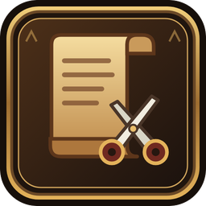

# QuestPruneForever

A compact quest log for World of Warcraft Forever. Copy the `QuestPruneForever` folder to `_forever_/Interface/AddOns/` and reload the UI.

Use `/qp` to open the quest list. Quest rows show available item rewards, money and XP. Protect keeps an individual quest from being abandoned. Every abandonment requires two clicks within three seconds, including with Shift held. Class and profession quest labels are inferred from quest-log headings and may be incomplete. Use `/qp dump` to print client API availability and quest data, `/qp debug` to toggle diagnostic output, and `/qp help` for commands. Further quest actions are planned for later versions.

The Abandoned tab lists quests abandoned through QuestPrune. For quests accepted while the add-on is running, it records the quest giver and the player's map position when the client makes them available. Click a saved entry or its Waypoint button to set a waypoint; TomTom is used if the client waypoint is unavailable. Coordinates are the player's position at the time, not a verified NPC location. Previously accepted quests or quests without available quest-giver data show unknown details. Reaccepting a quest removes it from the list.

The blue infinity icon and its filter use a simple approximation: quest IDs above 9665 are treated as post-Classic, based on the maximum in [Forever Quest Tint's Classic list](https://github.com/alexdia25/forever-quest-tint/blob/main/VanillaQuests.lua). This does not prove a quest is new to Forever, and lower IDs may also belong to later content.

For development, run the VS Code task **Install QuestPruneForever for testing** and enter the path to the game's `_forever_/Interface/AddOns` folder. Alternatively, run `python tools/install.py "<path to AddOns>"` in the terminal. Use `/reload` in game after installing.

Run `python tools/smoke.py` for the mocked smoke test (requires `python -m pip install --user lupa`). Run `python tools/build.py` to build and list the release ZIP in `dist/`.

Copyright (c) 2026 neXter. See [LICENSE](LICENSE).
