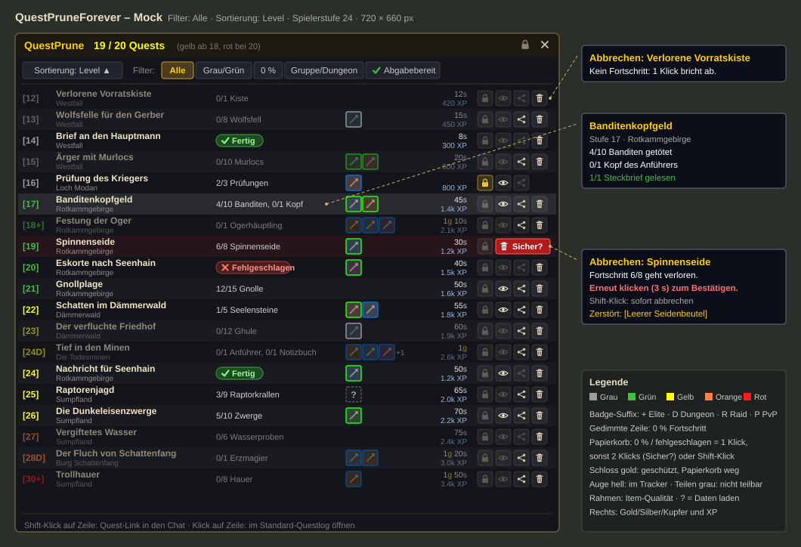

# QuestPruneForever

**QuestPruneForever** (im Spiel kurz *QuestPrune*) ist ein spezialisiertes Triage-Add-on gegen das chronische Quest-Log-Limit in WoW Forever. Es ersetzt das verschachtelte Standard-Log durch eine flache, informationsdichte Tabellenansicht mit direkten 1-Klick-Aktionen.

Das Add-on-Symbol zeigt eine Schriftrolle mit Schere in warmen Braun- und Goldtönen. Die eigene [SVG-Quelle](assets/icon.svg) und PNG-Varianten liegen lokal unter `docs/assets/`; das Spiel nutzt das 64×64-TGA in `Icons/`. Das Fenstermedaillon hat eine [eigene runde Vorlage](assets/medallion.svg) ohne den eckigen Rahmen.

Technische Umsetzung: [ENG-DESIGN.md](ENG-DESIGN.md).

### 1. Produktvision & Kernproblem

Das Standard-Questlog zwingt zu ständigem Klicken zwischen linker Liste und rechtem Detailfenster, versteckt Belohnungen am Ende langer Fließtexte und verlangt für jedes Abbrechen einen separaten Bestätigungsdialog. **QuestPrune** ist kein Ersatz zum Lesen von Quest-Lore, sondern ein reines **Aufräum- und Entscheidungs-Dashboard**: Öffnen per `/qp` oder Button im Standard-Questlog, in drei Sekunden sehen, welche Quests sich nicht mehr lohnen, und Platz schaffen.

Das runde QuestPrune-Symbol in der Titelleiste des Standard-Questlogs schließt dieses und öffnet QuestPrune; ein Tooltip erklärt die Funktion. Ein Klick auf eine Quest in QuestPrune öffnet ihre Details im Standard-Questlog und schließt QuestPrune.

**Grundsatz: volle Kontrolle.** Das Add-on entscheidet nichts selbst. Es gibt **keine Massenaktionen**; jede Quest wird einzeln und bewusst abgebrochen. QuestPrune macht diese Einzelentscheidung nur schneller und übersichtlicher als das Standard-Log.

### 2. UI-Layout & Informationsarchitektur

Das Fenster nutzt ein kompaktes Listen-Layout (**720 × 660 px**). Jede Quest hat eine Zeile von mindestens 28 px Höhe, die sich für mehrere oder umgebrochene Ziele vergrößert; jedes offene Ziel steht in einer eigenen Textzeile. Abschnittsüberschriften und Questzeilen scrollen per Mausrad, sobald sie nicht mehr ins Fenster passen. Das Fenster ist standardmäßig fixiert und lässt sich über das Schloss-Symbol im Fenstertitel (oder `/qp unlock`) entsperren und verschieben. `ESC` schließt es.

Die Gestaltung orientiert sich am klassischen WoW-Interface: ein vollständig deckender dunkler Hintergrund, Client-Dialograhmen, eine eigene dezent strukturierte braune Titelleiste, warme Goldtöne, eingefasste Bedienelemente, Blizzard-Schriften und feine Trennlinien. Ein rundes Medaillon mit dem Add-on-Icon sitzt oben links am Fenster. Questzeilen bleiben dabei gut lesbar und Aktionszustände klar erkennbar.

**Header-Bar (Überblick & Schnellfilter)**

* **Kapazitäts-Indikator:** Prominente Anzeige `19 / 20 Quests`. Färbt sich ab *Maximum − 2* gelb und beim Maximum rot. Das Maximum kommt vom Client, Fallback 20.
* **Sortier-Umschalter:** Ein Klick-Zyklus-Button mit Abschnittsüberschriften. Standard ist *Level*, gruppiert nach den Schwierigkeitsfarben des Clients; alternativ *Zone*, *Fortschritt* oder *Typ* (Solo, Klasse, Beruf, Gruppe/Elite, Dungeon, Schlachtzug, PvP, unbekannt). Überschriften belegen Listenzeilen und werden mitgescrollt.
* **Aktuelles Gebiet:** Ein schmaler goldener Akzent markiert passende Questzeilen und bei Gebietssortierung zusätzlich die Überschrift mit dem Hinweis „Aktuelles Gebiet“; dieses Gebiet steht dann zuerst. Das Gebiet wird mit den lokalisierten Client-Gebietsnamen verglichen und bei Gebietswechsel aktualisiert.
* **Schnellfilter (Einzelauswahl):** Kompakte Symbol-Buttons mit erklärendem Tooltip: *Alle*, *Grau/Grün*, *0 %*, *Gruppe/Elite*, *Dungeon*, *Schlachtzug*, *PvP*, *Abgabebereit*, *Nach Classic (ID > 9665)*, *Klasse*, *Beruf*. Ein erneuter Klick auf den aktiven Filter schaltet zurück auf *Alle*; Filter sind nicht kombinierbar. Filter ohne passende Quests sind ausgegraut.
* **Klasse und Beruf:** Namen sämtlicher Klassen und Berufe werden mit der lokalisierten Questlog-Überschrift verglichen. Die Kennzeichnung ist eine Näherung und bleibt zusätzlich zu Dungeon-, Gruppen- oder anderen Questtypen erhalten; nicht erkannte Quests sind nicht automatisch ausgeschlossen.
* **Quest-ID-Näherung:** Ein blaues Unendlich-Symbol und der gleichnamige Filter markieren IDs über 9665. Das ist eine einfache Grenze für Quests nach ursprünglichem Classic, kein Nachweis für eine neue Forever-Quest: spätere Classic- oder Saisonquests können ebenfalls dazugehören, und niedrigere IDs bleiben unbeurteilt.

**Die Quest-Zeile (4 Informationsblöcke + Aktionsspalte, von links nach rechts)**

1. **Level & Typ-Badge:** Vor dem Level markieren Symbole Gruppen-/Elite-, Dungeon-, Raid- und PvP-Quests; das Level selbst erscheint in der Schwierigkeitsfarbe (`GetQuestDifficultyColor`). Ein Tooltip erläutert den Typ.
2. **Quest-Titel & Zone:** Titel in Hauptschrift, direkt darunter dezent ausgegraut die Zone (z. B. *Rotkammgebirge*). Hover über den Titel zeigt Questbeschreibung und alle Ziele im Tooltip.
3. **Status & offene Aufgaben:**
   * *Abgabebereit:* grünes Badge mit Häkchen `Fertig`
   * *Fehlgeschlagen:* rotes Badge mit Kreuz `Fehlgeschlagen`
   * *In Arbeit:* die **offenen** Ziele stehen untereinander in der Questzeile, z. B. `4/10 Banditen` und darunter `0/1 Kopf`. Hover listet alle Einzelziele auf, erledigte in Grün.
   * Häkchen und Kreuz sind Client-Texturen, keine Schriftzeichen (die Spielschrift enthält ✓/✗ nicht verlässlich).
   * Unberührte Quests (`0 %`) werden dezent gedimmt, da hier beim Abbrechen kein Fortschritt verloren geht.
4. **Rewards auf einen Blick:**
   * Bis zu drei kleine **Item-Icons** (20 × 20 px) für Wahl- und Festbelohnungen mit Rahmen in der Item-Qualitätsfarbe; weitere als `+N`. Mouseover öffnet den nativen `GameTooltip` samt Ausrüstungsvergleich (`Shift`).
   * **Gold & XP:** rechts daneben übereinander (z. B. `45s` und `1.4k XP`), damit sofort erkennbar ist, ob eine Quest lukrativ ist oder nur Platz im Log frisst.

Rechts schließt die **Aktionsspalte** an (Abschnitt 3). Das Schloss zum Schützen einer Quest ist Teil dieser Spalte und kein eigener Informationsblock.

### 3. Actions pro Quest (Rechte Aktionsspalte)

Jede Zeile besitzt rechtsbündig Aktionen für sofortige Interaktion ohne Untermenüs. Schützen und Abbrechen zeigen jeweils Symbol und Beschriftung; die Fenstersperre im Titel verwendet ein einzelnes Schloss-Symbol.

| Action | Trigger | Verhalten & Sicherheitsnetz |
| --- | --- | --- |
| **Abbrechen (Ablehnen-Symbol)** | Linksklick | Bei jeder ungeschützten Quest färbt der erste Klick den Button für 3 Sekunden rot (`Sicher?`); erst der zweite Klick bricht ab. Auch mit gedrückter Shift-Taste gibt es keinen Sofortabbruch. Es gibt kein Modal-Popup. |
| **Schützen (Schloss)** | Linksklick | Speichert die `questID` in den SavedVariables und blendet den Papierkorb dieser Zeile aus, bis der Schutz wieder aufgehoben wird. Gedacht für lange Klassenquests oder Dungeon-Vorquests, die grau/grün sind, aber keinesfalls gelöscht werden dürfen. |
| **Tracking (Auge)** | Linksklick | Fügt die Quest über `C_QuestLog.AddQuestWatch` dem On-Screen-Tracker hinzu oder entfernt sie (`RemoveQuestWatch`), um auch den Bildschirm schnell aufzuräumen. |
| **Teilen** | Linksklick | Teilt die Quest mit der Gruppe. Nur aktiv, wenn `C_QuestLog.IsPushableQuest(questID)` zutrifft und man in einer Gruppe ist; sonst ausgegraut. |
| **Chat-Link** | `Shift + Klick` auf die Zeile | Fügt den Quest-Link in die offene Chat-Eingabe ein. |
| **Im Standard-Log öffnen** | Linksklick auf die Zeile | Öffnet das normale WoW-Questlog direkt auf dieser Quest, falls man doch einmal die komplette Geschichte oder Wegbeschreibung nachlesen möchte. |

### 4. Technische Architektur & Edge Cases (WoW Forever)

* **Abgebrochene Quests:** Ein eigener Reiter mit Symbol und lokalisierter Beschriftung zeigt Quests, die über QuestPrune abgebrochen wurden. Bei Annahme speichert das Add-on pro Charakter verfügbare Questgeberdaten und Kartenkoordinaten des Spielers; nach Wiederannahme verschwindet der Eintrag aus der Liste. Bei vorhandenen Koordinaten setzt ein Button oder Klick auf die Zeile einen Wegpunkt (Client-Wegpunkt, alternativ TomTom). Ältere Quests und nicht vom Client gelieferte Daten bleiben ausdrücklich unbekannt. Die Position ist die Spielerposition bei Annahme und keine bestätigte NPC-Position; automatisch wiederannehmen kann das Add-on die Quest nicht.
* **Asynchrones Reward-Caching:** Beim ersten Öffnen nach dem Login sind Item-Belohnungen einzelner Quests im Client oft noch nicht im lokalen Cache. Das Add-on ruft für solche Einträge einmalig `C_QuestLog.RequestLoadQuestByID(questID)` auf, zeigt am Reward-Slot einen Platzhalter (`?`) und aktualisiert die Zeile automatisch bei `QUEST_DATA_LOAD_RESULT`.
* **Debounced Live-Updates:** `QUEST_LOG_UPDATE` feuert in WoW extrem häufig (teils mehrfach pro Sekunde beim Looten). Ein kurzer `C_Timer.After(0.1, ...)`-Debounce bündelt Events. Ist das Fenster geschlossen, wird nur vermerkt, dass beim nächsten Öffnen neu aufgebaut werden muss.
* **Quest-Item-Warnung:** Gibt eine Quest beim Annehmen ein Quest-Item ins Inventar, das beim Abbrechen zerstört wird (`GetAbandonQuestItems()`), zeigt der Tooltip des Papierkorbs eine kurze gelbe Info (`Zerstört: [Quest-Gegenstand]`), blockiert aber den schnellen Klickfluss nicht mit einem Modal-Popup.
* **Persistenz:** Eine schlanke SavedVariable `QuestPruneForeverDB` mit
  * geschützten `questID`s **pro Charakter** (Einträge verschwinden automatisch, wenn die Quest abgegeben oder anderweitig entfernt wird),
  * Fensterposition und Fenstersperre,
  * zuletzt gewählter Sortierung und zuletzt gewähltem Filter,
  * Debug-Schalter (standardmäßig aus) und Fallback-Schaltern für unbestätigte Client-APIs.
* **Slash-Befehle:** `/qp` (Fenster), `/qp lock` / `unlock`, `/qp reset`, `/qp debug`, `/qp dump`, `/qp compat`, `/qp help`.

### 5. Offene Fragen

Spieltest mit Client 1.60.1 (Build 70938): Das Quest-Limit betrug 40, `QuestMapFrame` war vorhanden; Elite-, Dungeon- und PvP-Tags wurden geliefert. Zwei einzeln per Add-on abgebrochene Quests verschwanden aus dem Log. Quests ohne auslesbare Ziele gelten nicht als sicher unberührt und erfordern eine Bestätigung.

- [ ] **Quest-Limit:** Liefert `C_QuestLog.GetMaxNumQuestsCanAccept()` in Forever 20? Zählt `GetNumQuestLogEntries()` versteckte Quests mit? Im Spiel mit `/qp dump` prüfen.
- [ ] **Abbrechen per Add-on:** Ist `C_QuestLog.AbandonQuest()` in Forever (Midnight-ähnliche Einschränkungen) frei aufrufbar? Ohne das funktioniert das Add-on nicht in dieser Form.
- [ ] **Questlog-UI:** Hat Forever das klassische `QuestLogFrame` oder das Retail-`QuestMapFrame`? Bestimmt den Button im Log und den Linksklick „Im Standard-Log öffnen“. Fallback per `/qp compat openlog`.
- [ ] **Typ-Tags:** Liefert `C_QuestLog.GetQuestTagInfo()` Elite/Dungeon/Raid/PvP verlässlich, oder nur `suggestedGroup`?
- [ ] **Raid-Kennung:** Ist `Enum.QuestTag.Raid` in Forever vorhanden und entspricht es dem Tag einer Raid-Quest? Fehlt die Kennung, bleibt die Einstufung anhand von `suggestedGroup` als Gruppensymbol möglich; im Spiel prüfen.
- [ ] **Status-Icons:** Welche Client-Texturen eignen sich für Häkchen und Kreuz? Kandidaten: `Interface\RaidFrame\ReadyCheck-Ready` und `ReadyCheck-NotReady`.
- [ ] **Secret Values:** Bisher kein Hinweis, dass Quest-APIs betroffen sind; beim ersten Test im Debug-Banner prüfen.
- [ ] **Questgeber und Position:** Liefert Forever bei `QUEST_DETAIL` die Quest-ID, `UnitName("npc")` und über `C_Map` eine brauchbare Spielerposition? Bei fehlenden Daten wird im Reiter „Abgebrochen“ unbekannt angezeigt. Quests, die außerhalb von QuestPrune abgebrochen wurden, werden derzeit nicht zuverlässig als solche erkannt.
- [ ] **Wegpunkte:** Funktionieren `C_Map.SetUserWaypoint` und `C_SuperTrack.SetSuperTrackedUserWaypoint` für gespeicherte Karten in Forever? Bei fehlender oder nicht nutzbarer Client-API wird TomTom verwendet, sofern vorhanden; ohne gespeicherte Kartenkoordinaten wird kein Wegpunkt angeboten.
- [ ] **Kartenbutton-Rahmen:** `Interface\Minimap\MiniMap-TrackingBorder` erschien im Forever-Test versetzt; der Rahmen wurde nach dem Screenshot neu ausgerichtet und muss erneut im Spiel geprüft werden. `/qp compat mapbutton simple` zeigt das eigene Symbol ohne Client-Rahmen, `classic` aktiviert ihn wieder.
- [ ] **Fenstertexturen:** Passen `Interface\DialogFrame\UI-DialogBox-Background` und `UI-DialogBox-Border` in Forever? `/qp compat skin plain` schaltet auf die bisherige einfache Darstellung, `classic` aktiviert die Dialogtexturen wieder.
- [ ] **Belohnungen:** Liefern die Reward-Funktionen in Forever für jede Quest-ID passende Icons, Geld und XP und funktioniert `GameTooltip:SetQuestLogItem` mit Quest-ID? `/qp compat rewards selected` nutzt stattdessen die vorübergehend ausgewählte Quest; `direct` aktiviert wieder den Standardweg. Fehlende Daten erscheinen als Fragezeichen.
- [ ] **Forever-Quest-Erkennung:** Die ID-Grenze 9665 ist nur eine Näherung. Forever Quest Tint verwendet stattdessen eine interne Classic-Liste; seine Funktion und Daten sind laut Quellcode nicht öffentlich zugänglich. Niedrige IDs werden nicht als Classic bestätigt und hohe IDs nicht als spezifisch für Forever garantiert.
